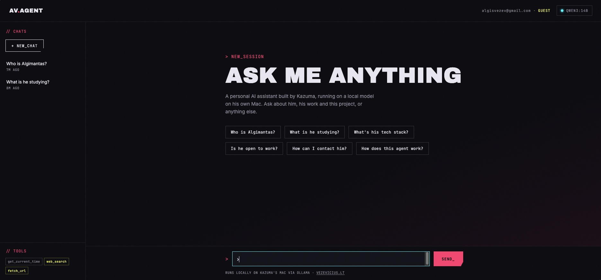
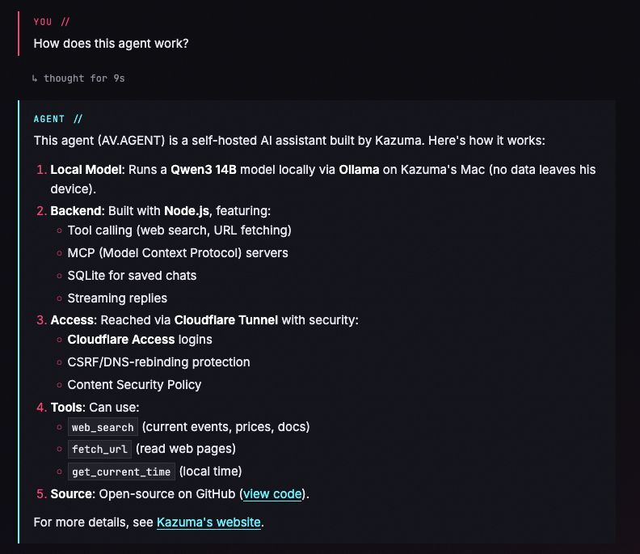
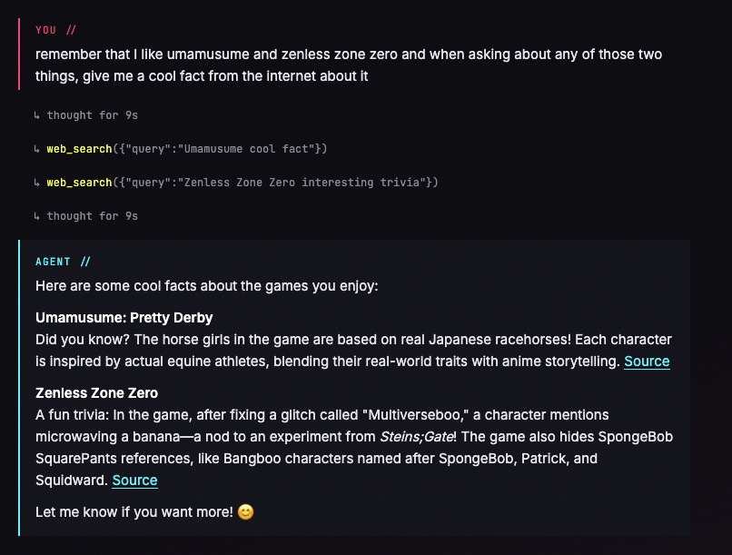
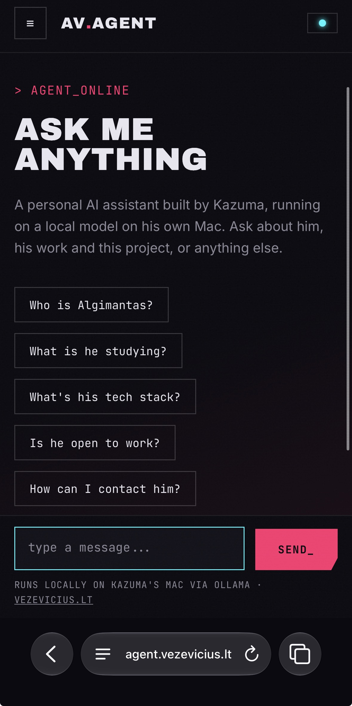

# AV.AGENT

A little side project I built for myself to try out [Ollama](https://ollama.com) and see how far a local model can go as a personal assistant.

Everything runs on my own Mac: the model (Qwen3 14B), the chats and the memory. It started as a 50-line terminal script and slowly grew into a small web app styled like my website, [vezevicius.lt](https://vezevicius.lt).

## What it can do

- Chat with a local model, with replies streaming in live
- Use tools: check the time, take notes, remember things about me, search the web
- Connect MCP servers for extra tools
- Answer questions about me, so friends can ask it who I am
- Ask before doing anything that changes data

  

## Built with

Node.js, Ollama, SQLite, Cloudflare Tunnel and plain HTML/CSS/JS.

Just a fun project, not production software.